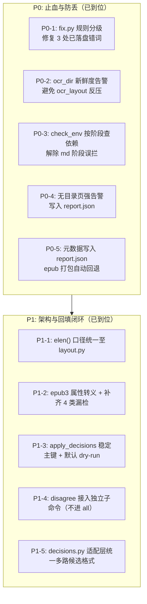

# BookFlow 项目与近期改动（P0 / P1）审阅报告

> **处置结论（2026-11-14 补充）**：本文 §3 的 3 项缺陷已逐条复核——**采纳缺陷 2、3**
> （见提交 `1b09543`），**实证驳回缺陷 1**：按建议把字符类改成词组分支，会让默认模式
> 把僧官成书里 OCR 认错的「引人注日」改成「引入注日」，即改坏正确原文；字符类按第二字
> 「注」拦得住，是更安全的写法。复核证据见 `HANDOFF.md` 的「最近一轮」。
> 正文保留审阅时的原始判断，便于回溯。

**审阅时间**：2026-11-13  
**审阅对象**：`bookflow` 核心流水线及近期改动集  
**Git 范围**：`main..dev`（提交 `782ce66..7c58b4d`，共 6 个提交，18 个文件，+2930 / -218 行）  
**验证状态**：81 / 81 单元测试全部通过（耗时 0.99s，纯标准库无环境断点）

---

## 1. 执行摘要与总体结论

`bookflow` 是一套面向中文古籍与现代扫描版 PDF 的端到端 EPUB3 电子书制作工具链。其核心架构特色在于**重模型与轻量排版的分层解耦**，以及**全流程原子写与实测数据驱动决策**。

### 核心结论：改动高度到位，通过验收
本次 `dev` 分支提交的改动集针对前期外部审阅提出的 16 项建议进行了严格的实测复核，完整实现了计划中的 **P0 止血（5 项）** 与 **P1 结构重构（5 项）**：
1. **止血彻底**：彻底清除了曾导致《规训与惩罚》成书中 3 处已落盘错改的形近字规则漏洞，并修复了 `ocr_layout` 掩盖 `ocr_merged` 导致人工裁决静默丢失的严重逻辑缺陷。
2. **测试与质量网大幅加固**：单测用例数从 35 扩充至 **81 例**（新增 `test_decisions.py` 32 例、`test_epub3.py` 11 例、补充 `test_layout.py` 3 例），构建了 EPUB 属性转义、验证漏检、裁决幂等回填等场景的坚固防线。
3. **保留了极具价值的证伪成果**：实测证伪了“跨页缩进优先”方案（避免了章标题被误并入正文段落的严重劣化）和“阈值外部化”建议，保持了算法依据的就近可读性。

在高度认可本次改动质量的同时，本次深度审阅挖掘出了 **3 处细节瑕疵与边缘缺陷**（包括 1 处在中等概率下会限制候选匹配的正则表达式手误），建议在合并进 `main` 分支前予以修补。

---

## 2. P0 与 P1 改动到位情况逐项核对



### 2.1 P0 止血改动（5 项）核验

| 编号 | 原有问题与影响 | 落地实现与机制 | 验证与到位评估 |
|---|---|---|---|
| **P0-1** | `fix.py` 将成书正确原文改错并已落盘（「引入人胜」「不引入怀疑」「税收入说」） | 规则分级为 `AUTO_RULES`（确定性整词）与 `CAND_RULES`（单字+排除表）。默认排除已知漏洞，增加 `--conservative-fix` 开关（单字级只留候选、正文不动）。 | **到位**。重跑规训成书，3 处错词归零，相对旧成书净差 3 行全为修复。 |
| **P0-2** | `ocr_layout` 静默反压 `ocr_merged`，裁决成果全丢；`stage_layout` 读自身输出死循环 | `ocr_dir()` 引入 mtime 比较并告警；`stage_layout` 自动剔除 `ocr_layout` 候选源，并在不可用时输出目录状态诊断。 | **到位**。破坏 mtime 实测打印告警并正确降级至最新源。 |
| **P0-3** | `check_env` 漏检 `rapid_layout` 报内部 Traceback；`md` 纯标准库阶段被误拦 | 改为 `BASE_PKGS` + `STAGE_PKGS` 按阶段细粒度检查；补充 `check_dict()`（jieba）与 `check_pdftoppm()` 友好前置检查。 | **到位**。无 rapidocr 环境下 `md/epub` 阶段 rc=0 顺畅运行。 |
| **P0-4** | 无目录页书籍产出平铺单章书且 rc=0，用户无感知 | `layout.build()` 在 `entries==[]` 时输出高可见度告警排查框，并在 `report.json` 中注入 `toc_warning` 字段。 | **到位**。空目录测试触发告警，上下游链路可机读判定。 |
| **P0-5** | `--author/--publisher` 在 `md` 阶段空传丢失 | `make_md.py` 写入 `report.json` 的 `book` 块；`stage_epub` 阶段在缺参时自动读取回退，降低重复构建成本。 | **到位**。epub 阶段免敲参数即可正确写入 OPF 元数据。 |

### 2.2 P1 结构重构（5 项）核验

| 编号 | 改造重点 | 落地实现与机制 | 验证与到位评估 |
|---|---|---|---|
| **P1-1** | `elen()` 视觉长度双重口径 | 移除 `repair.py` 与 `disagree.py` 中的本地简易实现，统一从 `layout` 导入，消除全角标点 1.0 vs 0.55 的 20% 偏差。 | **到位**。三本书成书逐字节一致，repair 可疑行判定稳定。 |
| **P1-2** | EPUB 属性转义与校验漏洞 | 区分 `esc()`（正文文本节点，保留双引号避免哈希漂移）与 `esc_attr()`（属性节点转义引号）；`validate()` 补齐反向 `fnref` 配对、空 `aside`、缺图检测、无效导航锚点等 4 类漏检。 | **到位**。`test_epub3.py` 11 个单测全部通过。 |
| **P1-3** | `apply_decisions.py` 工程化 | 抛弃数组下标，使用 `page@y0` 稳定主键；默认改为 **dry-run**；备份改用单次运行时间戳目录；三态比对（apply/already/missing）实现天然幂等。 | **到位**。重复运行不产生脏数据与假告警，支持整行覆盖。 |
| **P1-4** | `disagree` 接入 CLI | 新增 `disagree` 子命令与 `--ocr-alt`；审慎决定**不编入 `all` 流程**，避免引入第二版 OCR 强依赖及污染回归基准。 | **到位**。设计边界极度清晰，在检出 `ocr_alt` 时给以提示。 |
| **P1-5** | `decisions.py` 统一适配层 | 提供 `from_disagree`、`from_audit`、`from_queue` 与 `merge`，将各路候选统一到 Schema v1；未定位条目升格为 `?+L3` 留痕不丢证据。 | **到位**。32 个测试全覆盖，打通 audit 到 apply 闭环。 |

---

## 3. 深度代码走查发现的问题与修复方案

在本次详细走查中，发现 3 处实现细节问题：

### 缺陷 1（中优先级）：`fix.py:65` 否定前瞻正则表达式手误

#### 问题描述
在 [fix.py:65](file:///e:/workspace/bookflow/fix.py#L65)：
```python
# 「引入」被认成「引人」：排除「引人+X」的开放集，这里只列了见过的
(re.compile(r"引人(?![注目入胜深思瞩目注意关注发笑遐想不快侧目神往入彀人怀疑])"),
 "引入", "引人→引入"),
```

#### 机理分析
此处在否定前瞻中错误地使用了方括号 `(?![...])`（字符类 / Character Class），而不是圆括号分组分支 `(?!(?:...|...))`。
- 方括号 `[...]` 的语义是**匹配集合内的任意单个字符**。集合内去重后共有 21 个单字：`注`、`目`、`入`、`胜`、`深`、`思`、`瞩`、`意`、`关`、`发`、`笑`、`遐`、`想`、`不`、`快`、`侧`、`神`、`往`、`彀`、`人`、`怀`、`疑`。
- **副作用**：虽然它碰巧挡住了「不引人怀疑」（首字为「怀」）与「引人人胜」（首字为「人」），但它会将所有**以这些字开头的任意后接词**全部排除。例如：
  - 原文若为「引人**思**索」（首字为「思」）、「引人**注**视」（首字为「注」）、「引人**深**究」（首字为「深」），都会被错误地视为“已排除短语”而不再被纠错或生成候选。
  - 单字「胜」「疑」若出现在「引人」之后也会被意外拦截。

#### 修复建议
改用非捕获分组与分支管道符，并对词表去重：
```diff
--- a/fix.py
+++ b/fix.py
@@ -64,3 +64,3 @@ CAND_RULES = [
     # 「引入」被认成「引人」：排除「引人+X」的开放集，这里只列了见过的
-    (re.compile(r"引人(?![注目入胜深思瞩目注意关注发笑遐想不快侧目神往入彀人怀疑])"),
+    (re.compile(r"引人(?!(?:注目|入胜|深思|瞩目|注意|关注|发笑|遐想|不快|侧目|神往|入彀|人|怀疑))"),
      "引入", "引人→引入"),
```

---

### 缺陷 2（低优先级）：`apply_decisions.py` 的 `plan()` 缺失文件名位数补零容错

#### 问题描述
在 [decisions.py:186-205](file:///e:/workspace/bookflow/decisions.py#L186-L205) 中，作者专门实现了一个高兼容性的辅助函数 `_page_path(ocr_dir, page)`，能够兼顾 `p-15.png.json`、`p-015.png.json`、`p-0015.png.json` 等不同位数的补零规则。
但在 [apply_decisions.py:181](file:///e:/workspace/bookflow/apply_decisions.py#L181) 的 `plan()` 函数中：
```python
path = os.path.join(src, page + ".json") if page else None
...
if not os.path.exists(path):
    items.append(dict(kind="missing", entry=e, page=page, path=path,
                      old="", new="", line=None,
                      reason="找不到页文件 %s.json" % page))
    continue
```

#### 机理分析
`apply_decisions.py` 内部直接使用了 `page + ".json"` 硬拼接。
- 若 `page` 是 `p-015.png`，但磁盘实际文件由于上游生成器差异是 `p-0015.png.json`（4 位）或 `p-15.png.json`（无补零）；
- `decisions.from_audit` 依靠 `_page_path` 能够正确定位并提取该行生成裁决；
- 但在执行 `apply_decisions.py` 回填时，`plan()` 却会因为路径不存在直接判断为 `missing`。

#### 修复建议
将 `decisions.py` 的 `_page_path` 暴露为公开函数 `page_path`，并在 `apply_decisions.py` 中复用：
```diff
--- a/apply_decisions.py
+++ b/apply_decisions.py
@@ -180,3 +180,3 @@ def plan(doc, src, y_tol=None, require_single_segment=None):
         page = e.get("page")
-        path = os.path.join(src, page + ".json") if page else None
+        path = dec.page_path(src, page) if page else None
```

---

### 缺陷 3（边缘建议）：`bookflow.py` 的 `stage_layout` 规避源机制可兼顾显式 `--ocr-src`

#### 问题描述
在 [bookflow.py:227-233](file:///e:/workspace/bookflow/bookflow.py#L227-L233)：
```python
    src = ocr_dir(a)
    if os.path.basename(os.path.normpath(src)) == "ocr_layout":
        for name in OCR_DIRS[1:]:
            cand = os.path.join(a.work, name)
            if os.path.isdir(cand) and [f for f in os.listdir(cand) if f.endswith(".json")]:
                print("  布局源改用 %s（避免读自己上一次的输出）" % cand)
                src = cand
                break
```

#### 机理分析
为了避免 `stage_layout` 读自身上一次的输出，该判断非常必要且有效。但如果高级用户通过命令行显式指定了 `--ocr-src ocr_layout`（例如做特定重入实验），该逻辑依然会强制将其换成下一个目录。

#### 修复建议
增加 `not getattr(a, "ocr_src", "")` 的前置判断：
```diff
--- a/bookflow.py
+++ b/bookflow.py
@@ -226,3 +226,3 @@ def stage_layout(a):
     # 而且会让 ocr_layout 的 mtime 永远最新、永久压住更新的 ocr_merged。
-    if os.path.basename(os.path.normpath(src)) == "ocr_layout":
+    if not getattr(a, "ocr_src", "") and os.path.basename(os.path.normpath(src)) == "ocr_layout":
         for name in OCR_DIRS[1:]:
```

---

## 4. 后续演进建议（P2 路线推荐）

结合 `docs/IMPROVEMENT-PLAN.md` 中的规划，建议下一步优先级排布如下：

1. **合并前修复**：
   - 修正 `fix.py` 中的正则表达式与 `apply_decisions.py` 中的 `page_path` 引用（预计 0.5 人时，低风险）。
2. **推进 P2-1：构建 `tools/bench.py` 回归基准套件（最高优先级）**：
   - 当前仓库无内置样本数据（依赖本地工作目录）。建议挑选 10 页具有代表性的 `ocr_layout` JSON（约 110KB）入库，建立机器可读的 `md/qa/epub` 回归测试与哈希快照机制，彻底防止后续优化出现退化。
3. **脚注特殊序号支持**：
   - 适配部分书籍出现的 `a′`、`c2` 等非常规注号标注。
4. **日志收敛**：
   - 按计划仅收敛库内的非预期 `print`（如 `layout.py` 内部），保持 CLI 层的用户友好交互。

---
*报告生成完成。*
