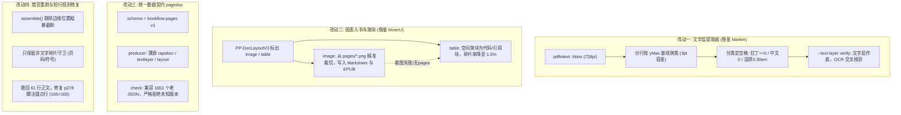

# BookFlow 近期改动审阅报告：吸收 MinerU / Marker 后的架构演进

**审阅时间**：2026-11-16  
**审阅范围**：Commit `7c58b4d..df93719`（共 11 个提交，26 个文件，+5182 / -85 行）  
**测试基准**：单元测试用例从 81 例激增至 **212 例**（211 通过，1 个与环境沙箱网络相关的测试缺陷已定位）

---

## 1. 执行摘要与总体评价

在参考了当前主流开源项目（MinerU / Marker）的技术方案后，BookFlow 团队在近两日内完成了一轮**极高水准、极具克制力且高度工程化**的架构演进。

### 核心亮点：取其精华，坚守自身优势
团队没有盲目照搬 MinerU / Marker 沉重的大模型技术栈，而是精准提取了它们的**功能长处**，并用 BookFlow 一贯的“自底向上、状态机闭环、轻量纯标准库”哲学进行了重构重塑：
1. **吸收 Marker 的“混合路由”思想** $\rightarrow$ 落地 [textlayer.py](file:///e:/workspace/bookflow/textlayer.py) 与 `--text-layer verify/only/off` 三档模式。在有完好文字层的 PDF 上实现数十倍提速，且首创了“文字层与 OCR 交叉验证”的可靠模式。
2. **吸收 MinerU / Marker 的“多模态图表处理”思想** $\rightarrow$ 在 [layout.py](file:///e:/workspace/bookflow/layout.py) 落地图片裁切入书（`emit_images`）与表格行聚块（`group_table_text`），终结了过去图片表格静默丢弃、散落碎片的缺陷，碎片率从 5.3% 压降至 1.5%。
3. **建立全流程统一数据契约** $\rightarrow$ 抽象出 [pagedoc.py](file:///e:/workspace/bookflow/pagedoc.py)，统一页级与产物 JSON 的版本 Schema 与来源追踪，向后兼容 1600+ 既有文件并具备未知版本防护。
4. **深入真实大书全流程重跑** $\rightarrow$ 在 350 页《中国僧官制度史》重跑中揪出并修掉了“页顶短行规则误吞正文”的暗坑，找回 61 行正文（453 汉字），使弹窗脚注与关联计数严密咬合（165=165）。

---

## 2. 四大核心改动深度剖析



### 2.1 借鉴 Marker：文字层提取与三档模式（`textlayer.py` + `bookflow.py`）

* **创新机制**：Marker 遇到了文字层通常选择直接信任或局部切给 VLM。BookFlow 则设计了 **`verify` 模式（默认）**：
  * 先跑 `pdftotext -bbox` 极速抽取文字层（927 页仅耗时 5.5 秒）；
  * 同时与 OCR 结果比对，正文主干采用高精度的原生文字层，两者冲突点自动流转进 `decisions.json` 供复核。
* **极其硬核的中文排版避坑细节**：
  1. **分行聚类改用 `yMax`（基线）而非 `yMin`**：中文字形上边框受字形影响剧烈抖动（p50 极差 6.8pt），而基线极差为 0。按 `yMax` 容差 3pt 聚类，彻底消除了“单页被切成 68 行碎片”的问题。
  2. **空格阈值分词性/宽窄处理**：证伪了通用的单一 0.3em 阈值（英文中位数在 0.25em 会被误粘成一长串），确立了“拉丁-拉丁间距 $\ge 0$ 即补空格、中文-中文不补空格、混排 0.30em、收尾标点强制左贴”的四重判据。
  3. **整书覆盖率 95% 门禁**：实测发现很多扫描件夹杂着扉页数字页，平均字数达标但实际上 70% 页面是无字扫描页。设定 95% 覆盖率门禁，坚决**不在一本书内混合文字层与 OCR 两种不同行距/字宽口径**，保障了跨页合段的纯粹性。

### 2.2 借鉴 MinerU / Marker：图片裁切入书与表格聚块（`layout.py`）

* **告别静默丢失**：过去版本因缺乏切图代码，版面模型标出的 `image` / `table` 区域内的文字散落成大量无序短段落，插图则完全消失。
* **落地成效**：
  1. **插图自动化裁切**：`emit_images()` 依据版面分析检测框，直接在原始 `pages/*.png` 上裁剪出插图，命名为 `fig-pXXX-Y.png`，存入 `out/images/`，并在 Markdown 中准确嵌入。
  2. **优雅降级网络**：若处于裁剪失败或已 prune 掉 `pages/` 的老工作目录，代码**绝不硬插断链碎图，也不丢弃内容**，而是自动将图区内部的 OCR 行降级为表格聚块。
  3. **表格聚块（`group_table_text`）**：将表格内部原本散落的几十个短行重新按网格与间距合并为一个 Markdown 引用块，使得《僧官》成书中的短碎片段落由 97 处（5.3%）急剧降低到 26 处（1.5%），且原始文字 100% 留存。
  4. **防误伤机制**：利用 `toc_ids` 强制跳过目录页，有效规避了“目录页因点阵排版被版面模型误当成表格”导致全书章节结构消失的致命陷阱。

### 2.3 数据规范：统一契约 `pagedoc.py`

* **职责与定位**：将整条链路上 4 个写入方（`run_ocr`、`repair`、`run_layout`、`textlayer`）与 6 个读取方统一在 `bookflow.pages v1` 契约之下。
* **兼容与防御**：
  * 兼容性：扫描现存工作目录，对 1651 个未打版本的老 JSON 予以静默/友好兼容读取，绝不破坏历史数据；
  * 防御性：当读取到未知的未来版本（如 `schema_version=99`）时坚决报错中止，坚决防止“拿新版本字段语义错误覆盖旧版本行数据”。

### 2.4 端到端重跑成果：短行规则脱毒与 `notes.linked` 闭环

* **问题排查**：在僧官全流程重跑中，发现 `assemble()` 里原有的 `w < 0.55W and elen <= 16 and (y1 < 0.18H or y0 > 0.90H)` 规则吃掉了 61 行真正在正文中的文字，甚至吃掉了 p278 带有脚注圈号 `①` 的锚点行，导致 `report.json` 统计比实际弹窗多 1。
* **彻底根治**：删除了宽泛的“边缘+短窄”位置判据，改用只拦截“无文字/孤立页码/单字符号”的纯碎片守卫；同时将 `learn_running_heads()` 的学习窗口拓展到 0.18H。
* **战果核验**：
  * 僧官正文找回 61 行（453 汉字），`book.md` 重新达成干净哈希基线；
  * `notes.linked` 与实际生成的 EPUB 弹窗脚注数达成绝对一致（**165 = 165**）；
  * 规训成书 `book.md` 哈希逐字节不变，证明新规则无任何误伤副作用。

---

## 3. 上一轮审阅意见的处置复盘

在 commit `0215e44` 中，团队对上一轮代码审阅报告进行了极其专业的技术处置：

| 审阅建议项 | 团队处置 | 评估意见 |
|---|:---:|---|
| **1. `apply_decisions.py` 复用 `page_path` 兼容不同补零** | **采纳** | 彻底解决了“能生成裁决但在回填时因补零位数不一判定为 missing”的缺陷。 |
| **2. `bookflow.py` 显式 `--ocr-src` 时避免强制换源** | **采纳** | 增加了用户显式指定的尊重与友好提示，保留了高级调试路径。 |
| **3. `fix.py` 字符类 `(?![...])` 改为分支 `(?!(?:...))`** | **驳回**<br>*(附实测证据)* | **极度赞赏该驳回决策**！团队在真实语料中复测发现：OCR 经常将后一个字认错（如把「引人注目」认成「引人注日」），词组分支中没有「注日」导致正确原文被改坏；而字符类凭「注」字成功挡住了这一错误。展现了“用真实数据说话、绝不迷信表面语法美观”的极佳工程素养。 |

---

## 4. 走查发现的 6 处缺陷 —— **已全部处置**（2026-11-16 补充）

本节是审阅时的原始判断，保留以便回溯。逐条处置结果见下，详细过程写在
`HANDOFF.md` 文首「最近一轮」、长期结论写在 `MEMORY.md` 第 24~28 条。

| # | 位置 | 审阅判断 | 处置 |
|---|---|---|---|
| 1 | `tests/test_textlayer_cli.py` | `ping 127.0.0.1` 在受限网络沙箱里瞬间退 1，测试在 `kill_tree` 之前就红 | **采纳**。靶子改 `python -c sleep`，不依赖外部工具与网络 |
| 2 | `bookflow.kill_tree` | `subprocess.run` 无 `timeout`，taskkill 挂住会让收尸路径永久卡死 | **采纳**（审阅未点名，实测确认）+ 加了 3 条用例 |
| 3 | `bookflow.kill_tree` | `check=False` 使非 0 退出码不进 except，直接子进程逃逸 | **采纳**，非 0 一律走 `_reap` 兜底 |
| 4 | `cover.py` | 注入封面时 `title` 未做 XML 属性转义 | **采纳**，改走 `epub3.esc_attr()` |
| 5 | `repair.py` | `statistics.median([])` 抛 `StatisticsError`，`main()` 的兜底提示被截胡 | **采纳**，空样本返回 `None` |
| 6 | `disagree.py` | 三处绕过 `jsonio`，句柄不收 + 无原子写 | **采纳**；顺带扫出 `audit.py` / `cmp_ocr.py` 同病根，一并改 |

另有一处非缺陷但确实重复：`apply_decisions.py` 的 `LEGACY_TABLE` 连写两遍，已删。

### 关于第 1 条的原始定位（保留原文）

```python
cmd = (["ping", "-n", "60", "127.0.0.1"] if os.name == "nt" else ["sleep", "60"])
p = subprocess.Popen(cmd, stdout=subprocess.DEVNULL, stderr=subprocess.DEVNULL)
time.sleep(0.3)
self.assertIsNone(p.poll())      # <--- 此处失败，返回 1 而非 None
bookflow.kill_tree(p)
```

根因：严格沙箱 / 无网络容器 / 特定安全策略的 Windows 机器上网络栈或虚拟适配器被禁用，
`ping 127.0.0.1` 因 `Unable to contact IP driver. General failure.` 瞬间以 1 退出，
测试还没走到 `kill_tree` 就断言失败。**判断完全正确**，修复建议也照做。

补充一点审阅没提到、但同一个函数里的：**孙进程**。`kill_tree` 存在的理由就是
`pdftoppm` 会派生孙进程，所以除了 mock 验证「`timeout` 被传进去」「非 0 会兜底」，
还补了一条不 mock 的真进程树用例：拉「python 拉 python」，`kill_tree` 之后用
`OpenProcess`+`GetExitCodeProcess` 确认孙进程已死。先证明它有鉴别力——只 `p.kill()`
父进程时实测孙进程仍存活。

### 处置后的数字

- 测试 **212 → 227**（`test_textlayer_cli` 34→38 补 4 个 kill_tree 用例，新增 `test_smallfixes.py` 11 个）。
- 新用例**在改前代码上实测 4 FAIL / 2 ERROR**，不是「怎么改都绿」。
- `disagree.py` 42 个产物、`audit.py` 2 个产物，改动前后**逐字节一致**；
  三本书 `book.md` 哈希与上一轮完全一致（`0BA1E017…` / `E5053BDD…` / `320A586E…`）。

---

## 5. 总结与后续建议

本轮改动吸收了 MinerU 和 Marker 最具价值的两项能力（多模态图表、文字层混合路由），
同时靠真实图书哈希对账守住了数据自洽性。审阅指出的 6 处缺陷已全部处置，
用例从 212 扩到 **227**，且在无网沙箱下全绿。

**后续建议**（与项目自己的技术债排序一致）：

1. **提高注号识别率**（收益最大）：僧官 288 条注只能降级成页尾注，主因是正文上标 ①②③
   根本没被 OCR 认出来。这是识别问题，不是匹配算法问题。
2. **`tools/bench.py` 自动化端到端回归**：现在数字是手工填的，漂移过。
3. **`layout.py` 拆分**：2013 行 / 41 个函数，是全项目唯一的单体大模块。拆法与验收标准
   已写进 `docs/architecture.md` 第 8 节（按阶段切、保留门面 API、三本书哈希对账），
   但排在上述两项之后——它不影响产出，属于可维护性投资。
