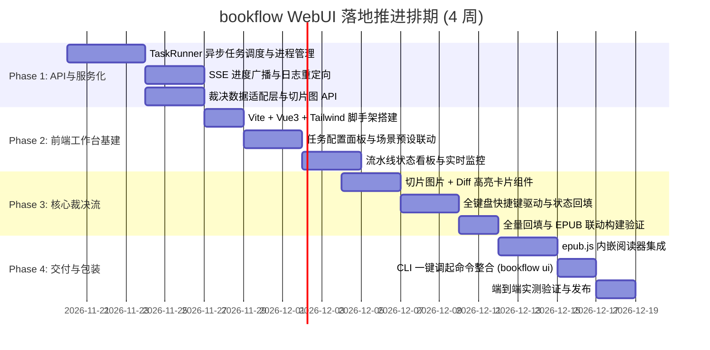

# bookflow WebUI 工作台落地实施计划

## 1. 项目定位与目标

将 **bookflow** 从原有的纯 CLI 脚本驱动模式，升级为支持**“零配置预设、流式全流程监控、键盘驱动的裁决审批台、EPUB 即时质检”**的现代化本地 Web 工作台。

### 核心指标与交付目标
- **输入阻力归零**：拖入 PDF + 选预设，3 秒内开启转换任务。
- **过程确定性 100%**：全流程实时阶段进度可视化（包含耗时预估 ETA、当前页数、断点续传）。
- **裁决人效提升 5~10 倍**：将原本需人肉比对长图 `review.png` 并手工改 JSON 的流程，升级为**全键盘卡片式秒级 A/B 裁决**。
- **成书质检无缝闭环**：无需外部阅读器，在浏览器内即可直接点开 EPUB 弹窗脚注验证排版。

---

## 2. 总体系统架构设计

系统采用**前后端轻量解耦、本地独立运行**的架构模式。核心 Python 业务代码保持独立可测试，上层通过异步 API 暴露状态。

```mermaid
flowchart TB
    subgraph Frontend["前端 SPA (Vue 3 / Vite / Tailwind / Pinia)"]
        UI_Cfg[任务配置与预设面板]
        UI_Dash[实时流水线看板 & 日志]
        UI_Triage[核心：A/B 刷卡片式裁决审批台]
        UI_Reader[epub.js 内嵌弹窗脚注阅读器]
    end

    subgraph Backend["后端服务 (FastAPI / Uvicorn)"]
        API_Route[RESTful 路由 + SSE 流式网关]
        Task_Mgr[任务调度与进程树监控 (TaskRunner)]
        Data_Bridge[decisions / report / ocr 数据适配器]
    end

    subgraph Core["bookflow 核心引擎 (纯标准库 + 既有模块)"]
        Engine_OCR[run_ocr.py / repair.py]
        Engine_Layout[layout.py / make_md.py]
        Engine_Decide[apply_decisions.py / disagree.py]
        Engine_EPUB[epub3.py]
    end

    UI_Cfg -->|POST /api/jobs/start| API_Route
    API_Route -->|SSE /api/jobs/stream| UI_Dash
    API_Route <-->|GET & POST /api/decisions| UI_Triage
    UI_Reader <-->|GET /api/epub/file| API_Route

    API_Route --> Task_Mgr
    Task_Mgr --> Core
    Data_Bridge <--> Core
```

---

## 3. 核心功能模块设计

### 模块一：任务创建与预设面板 (Job Setup)
- **PDF 拖拽入口**：支持拖入本地文件或输入路径。
- **自动提取元信息**：读取 PDF 元数据，智能预填书名、作者、出版社。
- **三大场景预设（Preset）**：
  - `古籍与纯扫描本`：`--text-layer off` + `--conservative-fix` + 版面分析增强；
  - `现代学术排版`：`--text-layer verify` + 自动双模型交叉验证；
  - `前 20 页极速打样`：限制提取前 20 页，1 分钟内跑通微缩成书供排版预览。

### 模块二：流水线流式看板 (Pipeline Monitor)
- **阶段进度展示**：`Render` $\to$ `TextLayer` $\to$ `OCR` $\to$ `Layout` $\to$ `Assemble` $\to$ `EPUB`。
- **实时指标跟踪**：已处理页码、当前阶段耗时、剩余预估时间（ETA）、显卡/设备状态。
- **安全控制**：一键“暂停/安全中断”，底层严格调用 `kill_tree` 清理子进程，杜绝句柄占用与孤儿进程。

### 模块三：人机协同裁决审批台 (Visual Triage Station)
> [!IMPORTANT]
> 这是整个界面的核心价值承载点，必须遵循**“键盘优先（Keyboard-first）、低认知负荷”**的原则。

- **三屏协同卡片布局**：
  - **左区（证据原图）**：根据 `y0, y1, x0, x1` 自动裁切原始扫描页对应的整行高分辨率切片图（带 $\pm8\text{px}$ 视觉留白）；
  - **中区（候选对账）**：并排对比 `A 版 (主模型/文字层)` 与 `B 版 (第二意见/词表建议)`，字符级高亮差异点；
  - **右区（操作面板）**：显示词频证据（如 `词表判 A 强: 自己 90933 vs 自已 263`）。
- **极速键盘快捷键操作**：
  - `[1]` 或 `[A]`：采纳 A（保留原样）；
  - `[2]` 或 `[B]`：采纳 B（替换为第二候选）；
  - `[3]` 或 `[Tab]`：激活自定义手写输入框覆盖；
  - `[Space]`：跳过/标记为未定（`?`）；
  - `[Enter]`：确认并切到下一条。
- **批量动作**：提供“全部采信高置信建议”按钮，最后统一提交直接回填 `decisions.json`。

### 模块四：成书质检与 EPUB 原生阅读器 (Inspect & Reader)
- **目录树可视检视**：图形化列出解析出的章节树（Level 1~3），展示命中页码与未命中条目提示。
- **注释健康仪表盘**：直观展示 `可弹窗脚注数` / `页尾注降级数` / `断链异常数`。
- **嵌入式预览（集成 epub.js）**：直接在界面右侧抽屉式拉出电子书阅读器，点击上标 `①` 即可原地验证弹窗浮层效果。

---

## 4. 技术栈选型规范

| 层次 | 选型组件 | 选用理由 |
|---|---|---|
| **后端框架** | **FastAPI + Uvicorn** | 原生异步支持，与 Python 核心引擎零跨语言损耗；轻量级开箱自带 Swagger 文档。 |
| **实时通信** | **Server-Sent Events (SSE)** | 单向流式推日志和进度比 WebSocket 更轻量、更稳定，防掉线重连机制极其简单。 |
| **前端框架** | **Vue 3 (Composition API) + Vite** | 构建极速，响应式状态管理简单；**与未来的 Tauri 桌面端天然 100% 兼容**。 |
| **样式与组件库** | **Tailwind CSS + Lucide Icons** | 定制紧凑型、高密度生产力布局（密集表格、切片图并排、状态徽章）最灵活。 |
| **电子书阅读** | **epub.js** | 业界成熟的标准 EPUB 3 网页渲染引擎，原生支持 HTML/CSS 弹窗样式调试。 |
| **桌面演进路线** | **Tauri (Phase 2)** | 前端资产（Vue 3 构建产物）零改动直接被 Tauri 消费，资源占用远低于 Electron，分发体积极小。 |

---

## 5. 后端核心 API 契约定义

```http
### 1. 启动任务
POST /api/jobs/start
Content-Type: application/json
{
  "pdf_path": "D:/books/中国僧官制度史.pdf",
  "preset": "scan", // scan | modern | sample
  "title": "中国僧官制度史",
  "author": "谢重光",
  "sample_pages": 20
}

### 2. 实时流式进度 (SSE)
GET /api/jobs/{job_id}/stream
Response: text/event-stream
data: {"stage": "ocr", "page": 120, "total": 350, "percent": 34.2, "eta_seconds": 180}

### 3. 获取待裁决差异列表
GET /api/jobs/{job_id}/decisions
Response:
{
  "total": 42,
  "pending": 18,
  "items": [
    {
      "key": "p-015.png@2109.6",
      "crop_url": "/api/crops/p-015.png?y0=2109&y1=2140",
      "A": "基层僧官之自然是",
      "B": "基层僧官之自然是有",
      "verdict": "?",
      "diff": [{"op": "replace", "a": "是", "b": "是有"}],
      "why": "词表建议: 有 词频较高"
    }
  ]
}

### 4. 提交裁决并触发成书
POST /api/jobs/{job_id}/decisions/apply
Content-Type: application/json
{
  "decisions": [
    {"key": "p-015.png@2109.6", "verdict": "B"}
  ],
  "rebuild_epub": true
}
```

---

## 6. 四阶段落地排期（WBS）



### 里程碑交付物说明
- **Phase 1（后端服务化）**：实现 `TaskRunner` 类，让既有脚本函数在后台线程/子进程安全运行，中断时不留孤儿进程；开发裁决项切片图动态裁剪路由。
- **Phase 2（输入与看板）**：完成拖拽上传、预设选择与实时 SSE 步骤进度卡片。
- **Phase 3（裁决工作台 MVP）**：实现左图右文 A/B 裁决卡片，键盘流秒级审批，打通 `apply_decisions.py` 回填逻辑。
- **Phase 4（成书与闭环）**：成书内置预览，并将前端构建产物打入包内，支持终端直接输入 `python bookflow.py ui` 自动拉起浏览器。

---

## 7. 风险识别与应对措施

| 潜在风险 | 影响程度 | 防范与解决方案 |
|---|:---:|---|
| **多核/GPU 资源竞争导致界面卡死** | 高 | FastAPI 主线程跑异步事件循环，重型 OCR/渲染任务严格隔离在独立的 `multiprocessing.Process` 中，避免 GIL 锁死 Web 服务。 |
| **长任务执行中断导致状态错乱** | 中 | 每次任务生成唯一 `job_id`，中间产物与任务元数据即时落盘 `work/job.json`，服务重启后可基于本地文件恢复进度。 |
| **本地端口占用与权限拦截** | 低 | 启动脚本自动探测可用随机端口（默认 8000，占用则递增至 8001），并以 `127.0.0.1` 环回绑定，防止防火墙报警。 |
| **跨平台文件路径斜杠问题** | 低 | 前后端交互一律采用 POSIX 标准斜杠或基准相对路径，服务端通过 `os.path.normpath` 统一解析。 |
